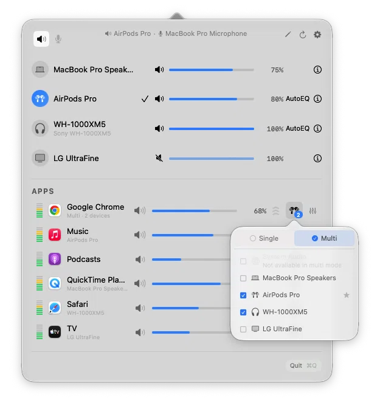
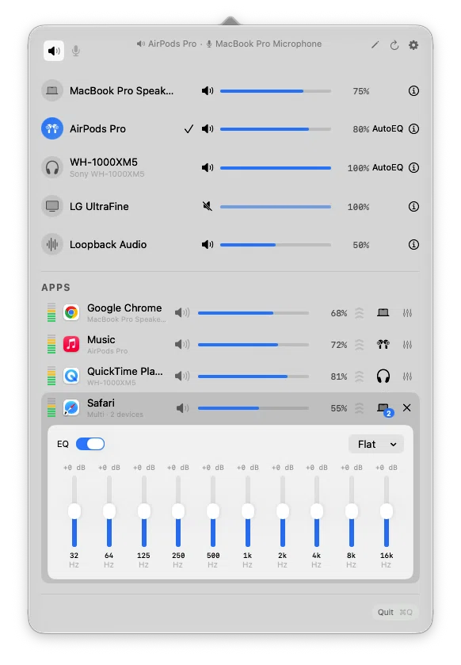

<div align="center">
  <picture>
    <source media="(prefers-color-scheme: dark)" srcset="docs/assets/icon-dark.png">
    <source media="(prefers-color-scheme: light)" srcset="docs/assets/icon-light.png">
    
  </picture>

  <h1>FineTune-Rewrite</h1>

  <p>
    <a href="https://github.com/ph0ryn/FineTune-Rewrite/releases"></a>
    <a href="https://github.com/ph0ryn/FineTune-Rewrite/actions/workflows/check.yml"></a>
    
    <a href="LICENSE"></a>
  </p>
</div>

A macOS menu bar app for controlling per-app volume, output routing, equalizer settings, and audio devices.

A reimplementation targeting the core functionality of [FineTune](https://github.com/ronitsingh10/FineTune), supporting per-app volume, boost, 10-band EQ, headphone correction (AutoEQ), device priority ordering, global hotkeys, and URL scheme automation.

<p align="center">
  
</p>
<p align="center">
  
</p>

> [!WARNING]
> This project is under active development. If you encounter any bugs or issues, please feel free to open an [issue](https://github.com/ph0ryn/FineTune-Rewrite/issues) or submit a [pull request](https://github.com/ph0ryn/FineTune-Rewrite/pulls).

## Requirements

- macOS 15.4 or later

## Install

### GitHub Releases

Download `FineTuneRewrite.dmg` from [Releases](https://github.com/ph0ryn/FineTune-Rewrite/releases) and copy `FineTuneRewrite.app` into your `Applications` folder. Builds target Apple Silicon (`arm64`).

Because the bundle is ad-hoc signed, Gatekeeper may block the first launch. Right-click the app in Finder and choose **Open**, or remove the quarantine attribute:

```bash
xattr -dr com.apple.quarantine /Applications/FineTuneRewrite.app
```

### Build from Source

Requires Xcode, Xcode Command Line Tools, and [just](https://just.systems/).

```bash
just build-app release
```

This produces `DerivedData/Build/Products/Release/FineTuneRewrite.app`.

## Features

### Per-App Audio Control

- **Volume, Mute, and Boost** — Adjust volume sliders, type exact percentages, mute, and apply volume boost for each active app, with live level meters.
- **Output Routing** — Choose between **Single** (system default or a specific output device) and **Multi** (simultaneous output to multiple devices) per app.
- **10-Band Equalizer** — Tune 10 frequency bands (32 Hz to 16 kHz) per app with built-in presets and custom saved presets.
- **Pin and Ignore** — Pin apps to keep them visible or hide them with **Ignore App** from edit mode or the context menu.

### Audio Device Management

- **Output and Input Switching** — Switch between **Output Devices** and **Input Devices** from the header tabs to change default devices and control device volume and mute.
- **Priority and Visibility** — Reorder device priority in edit mode by dragging, hide unused devices, and customize device icons.
- **Bluetooth Connection** — Connect to paired Bluetooth audio devices from edit mode under **Output Devices**.
- **Headphone Correction (AutoEQ)** — Open **AutoEQ** on supported output devices to search, favorite, and apply headphone profiles, or import a `ParametricEQ.txt` file.

### Keyboard Navigation

- **Popup Controls** — Navigate rows with Up/Down arrows, adjust volume with Left/Right arrows, type digits to set a percentage, press `M` to toggle mute, and press `Tab` to switch between output and input tabs.

## Configuration

Open **Settings** from the gear icon in the top-right corner of the menu bar popup.

- **General** — Configure launch at login, theme, **Device Disconnect Alerts**, menu bar **Icon Style**, **Popup Size**, and **Reset** all settings.
- **Audio** — Configure **Live Audio Processing** (enable or disable per-app audio processing), **Default Volume** for new apps, **Loudness Compensation**, **Lock Input Device**, **System Sounds** output, and **Alert Volume**.
- **Shortcuts** — Configure **Volume Step**, **Media Keys Control** (volume key integration and **HUD Style**), and global hotkeys for toggling the popup or controlling the active app.

## Integrations

Automate per-app audio from scripts or external tools using the `finetune://` URL scheme.

| Action | Format | Description |
| --- | --- | --- |
| Set volume | `finetune://set-volumes?app=<id>&volume=<0-100>` | Set volume for one or more apps (repeatable pairs). |
| Set mute | `finetune://set-mute?app=<id>&muted=<true\|false>` | Set mute state for one or more apps (repeatable pairs). |
| Toggle mute | `finetune://toggle-mute?app=<id>` | Toggle mute state for an app. |
| Step volume | `finetune://step-volume?app=<id>&direction=<up\|down>` | Step volume up or down (`+` / `-` also accepted). |
| Set output device | `finetune://set-device?app=<id>&device=<uid>` | Route an app to the specified output device UID. |
| Reset | `finetune://reset` / `finetune://reset?app=<id>` | Reset volume and mute for all apps or a specific app. |

```bash
open "finetune://set-volumes?app=com.spotify.client&volume=50"
```

## Troubleshooting

- **Per-app volume control has no effect or shows a permission warning** — When **Allow System Audio** or **Open System Settings** appears at the top of the popup, grant System Audio Recording permission and click **Retry Audio** in the header. Also check that **Live Audio Processing** is enabled under **Settings** → **Audio**.
- **Media keys do not respond (`Media key control is offline.`)** — Grant Accessibility permission via **Allow Access** under **Settings** → **Shortcuts**. If the offline banner appears, click **Try Again** in the same tab.
- **Inspect audio route diagnostics** — Launch the app with `FINETUNE_AUDIO_DIAGNOSTICS=1` to record diagnostic events to the unified log under subsystem `com.finetune-rewrite` and category `AudioRoute`. See [reference.md](docs/reference.md) for field definitions.

## Documentation

- [spec.md](docs/spec.md)
- [architecture.md](docs/architecture.md)
- [verification.md](docs/verification.md)
- [development.md](docs/development.md)
- [reference.md](docs/reference.md)

## Development

Format checks require `clang-format` 21.1.8.

```bash
just check
```

Common tasks:

- `just check` — Run format lint, unit and contract tests, offline DSP tests, and native boundary tests.
- `just build` — Build the Swift package.
- `just test-ui` — Run rendered UI tests.
- `just build-app` — Build the debug macOS app bundle.
- `just format` — Format Swift and C/C++/Objective-C++ sources.

## License

Original code is licensed under the [MIT License](LICENSE); components derived from FineTune are licensed under `GPL-3.0-only`. See [THIRD_PARTY_NOTICES.txt](App/Resources/THIRD_PARTY_NOTICES.txt) for component details, copyright notices, and license texts.
